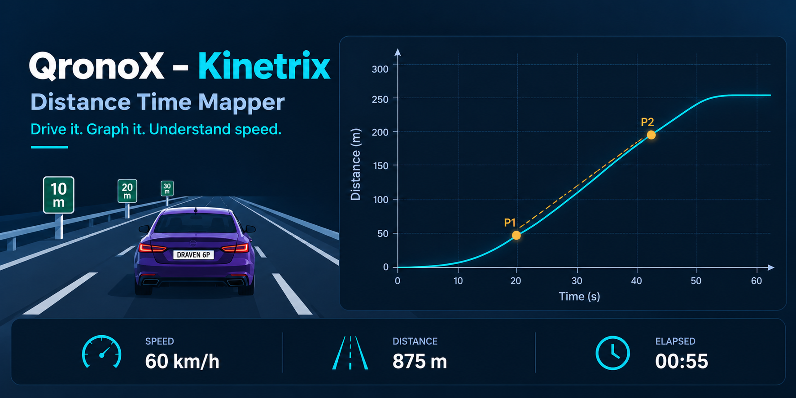

**QronoX – Kinetrix**

**Interactive Distance–Time Graph Simulator**

>Explore motion, speed, distance, and time through an interactive driving simulation.

[**Explore the Simulation →**](YOUR_DEPLOYED_URL)

---

🔸 **Features**

- 🚗 **Interactive Driving** — Accelerate and brake.
- 📈 **Live Graph** — Visualize distance against time.
- ⚡ **Speedometer** — Track speed in km/h.
- 📏 **Odometer** — Measure distance in metres.
- ⏱️ **Timer** — Monitor elapsed time.
- 🎮 **Simulation Controls** — Play, pause, stop, resume, and reset.
  
---

🔸 **Learning Objectives**

Understand motion, acceleration, constant speed, braking, and distance–time graph gradients.

---

🔸 **Technology**

- HTML5
- CSS3
- JavaScript
- Canvas / SVG

---

🔸 **Credits**

- **OpenAI** : Initial code implementation
- **Claude** : Subsequent code architecture
- **Perplexity** : Scientific validation and debugging
  
---

🔸 **License**

Licensed under the [MIT License](LICENSE).
